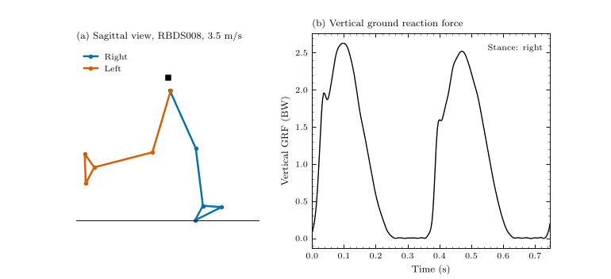
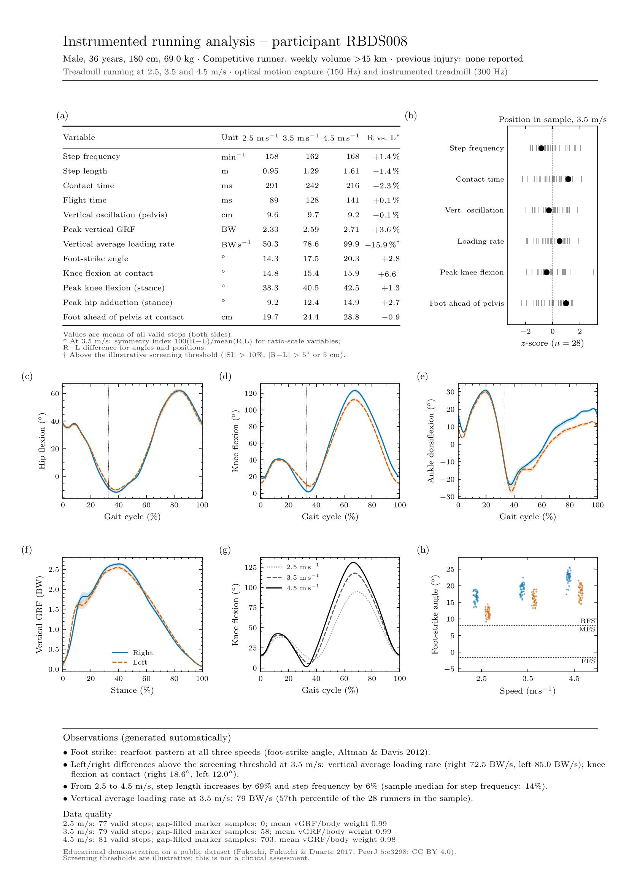
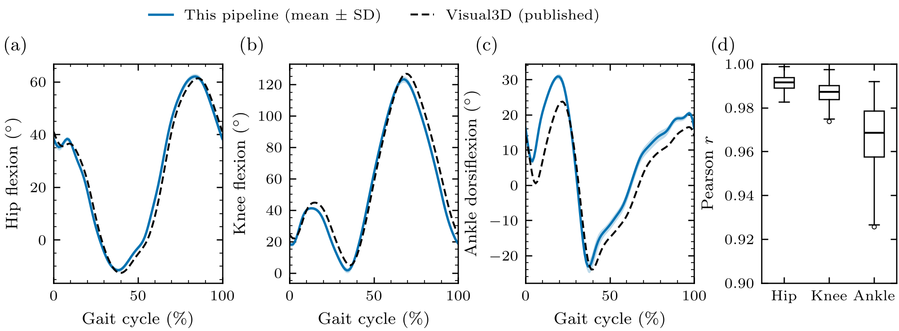
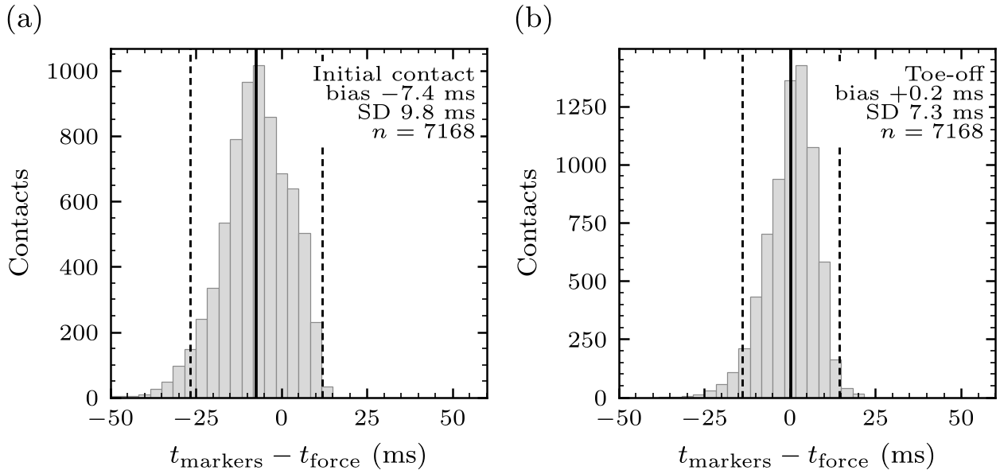
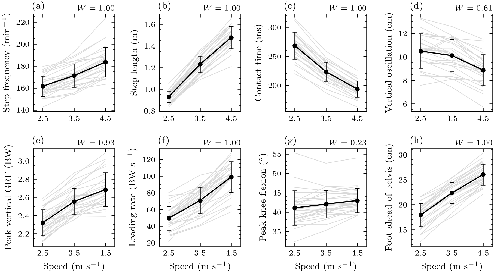
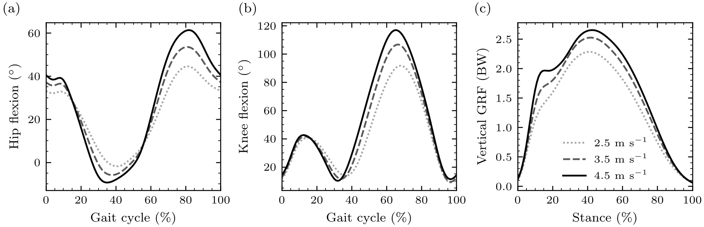

# Running gait analysis: from 3D motion capture to an athlete report

A Python pipeline for **treadmill running analysis with optical 3D motion capture and an
instrumented treadmill**. It reads raw C3D files and runs data-quality checks, reconstructs
segments and joint angles, detects gait events, computes clinical/sports metrics and
left/right symmetry, and writes a **one-page report per runner**. Every step is validated
against independent references.

Built on a public dataset of 28 runners at 2.5, 3.5 and 4.5 m/s (84 trials, 7 004 analysed steps).

<p align="center">
  
</p>

| Athlete report (example) | What the pipeline does |
|---|---|
|  | **1. Load:** C3D markers (150 Hz) and treadmill force (300 Hz) via `ezc3d`<br>**2. Quality control:** label-swap detection, gap filling (spline / rigid body), force plausibility check, full QC log<br>**3. Kinematics:** static calibration, least-squares rigid-body tracking, hip/knee/ankle angles<br>**4. Events:** initial contact and toe-off from force *and* from markers only<br>**5. Metrics:** temporal, kinetic, kinematic, foot-strike pattern, symmetry<br>**6. Report:** one PDF page per runner with plain-language observations<br>**7. Validation:** against published Visual3D results and the force plate<br>**8. PROMs:** KOOS questionnaire scoring |

---

## Highlights

**Validation against independent references** ([`results/VALIDATION.md`](results/VALIDATION.md))

| Check | Result |
|---|---|
| Hip / knee / ankle flexion curves vs. published Visual3D curves (504 curves) | median r = 0.991 / 0.987 / 0.969 |
| Peak vertical GRF vs. published processed data | r = 0.994, mean difference +0.03 BW |
| Marker-only initial contact vs. force plate (7 168 contacts) | bias −7 ms, SD 10 ms (1 frame = 6.7 ms) |
| Marker-only toe-off vs. force plate | bias 0 ms, SD 7 ms |
| Mean vertical force over each trial / body weight (should be 1) | median 0.98, all 84 trials within ±7 % |



*Figure 1. Sagittal joint angles of one participant (RBDS008, right side, 3.5 m/s) from this pipeline (mean ± SD of all strides) and from the published Visual3D processing (a–c), and distribution of the Pearson correlation between the two for all 504 curves (d).*



*Figure 2. Difference between marker-based and force-plate-based event times for 7 168 foot contacts: initial contact (a) and toe-off (b). Solid line: bias; dashed lines: 95 % limits of agreement.*

**Data quality issues found in the raw data and handled automatically**

* **Swapped marker labels** (right MT1 ↔ MT5, one runner, two trials): detected because the
  rigid-body fit residual of the foot jumped from ~1 mm to 46 mm; the correct swap was found
  by testing all label permutations and applied automatically.
* **Markers absent from the whole file** (MT1 in 7 trials): reconstructed from the other four foot markers.
* **Gaps** of up to 36 frames: 46 177 samples (0.38 %) filled by spline or rigid-body
  reconstruction; every fill is logged per trial in [`results/qc_all.csv`](results/qc_all.csv).
* **Inconsistent file names** and extra trials outside the protocol: normalised / excluded.

**How runners adapt to speed** ([`results/SPEED_EFFECTS.md`](results/SPEED_EFFECTS.md))

From 2.5 to 4.5 m/s, step length increases by 59 % but step frequency only by 14 %. Contact time
falls from 269 to 194 ms, and the vertical loading rate doubles (49 → 99 BW/s).
All 28 runners change in the same direction for these metrics (Kendall's W = 1.0).



*Figure 3. Effect of running speed on eight metrics (a–h). Grey: individual runners; black: mean ± SD (n = 28). W: Kendall's coefficient of concordance from the Friedman test.*



*Figure 4. Group-mean hip (a) and knee (b) flexion over the gait cycle, and vertical ground reaction force over stance (c), at the three speeds (right side, n = 28).*

---

## Relation to photogrammetry

Optical motion capture (Vicon, Qualisys, …) is **close-range photogrammetry**: calibrated
cameras triangulate retro-reflective markers. The step after triangulation, finding a body
segment's pose from its marker cluster, is a **least-squares rigid-body (Helmert) transformation**,
and its residual is a precision measure, just like residuals in a bundle adjustment. This
pipeline uses that residual as its main quality signal (for example to detect the swapped labels above).

## Quick start

```bash
git clone https://github.com/HamedJamz/running-gait-analysis.git
cd running-gait-analysis
pip install -r requirements.txt

python scripts/download_data.py        # ~230 MB from Figshare (CC BY 4.0)
python scripts/cutoff_analysis.py      # residual analysis -> filter cut-off
python scripts/run_all.py              # process 84 trials (~1 min)
python scripts/validate.py             # validation report + figures
python scripts/speed_effects.py        # group statistics + figures
python scripts/make_reports.py         # one A4 PDF per runner -> results/reports/
python scripts/make_animation.py       # stride GIF
python examples/koos_demo.py           # KOOS scoring example (synthetic data)
pytest -q                              # 16 unit tests on synthetic data
```

Figures are typeset with LaTeX (Computer Modern) when `latex`, `dvipng` and `cm-super` are installed
(e.g. `apt install texlive-latex-extra dvipng cm-super`); otherwise matplotlib's built-in
Computer Modern fonts are used automatically. Every figure is saved as vector PDF and as PNG.

Process a single runner from Python:

```python
from rungait.pipeline import process_subject
res = process_subject("RBDS008", "data/raw", body_mass=69.0)
print(res[3.5].summary)          # metrics per side + symmetry
print(res[3.5].qc)               # what was filled / corrected
```

## Repository structure

```
rungait/            the package
  io.py             C3D loading (ezc3d), file indexing, metadata
  qc.py             label-swap detection, gap filling, force plausibility
  signal.py         Butterworth filter, spline gap filling, Winter residual analysis
  kinematics.py     static calibration, SVD rigid-body tracking, joint angles
  events.py         force-plate and marker-only gait events
  metrics.py        step metrics, loading rate, foot strike, symmetry, curves
  report.py         one-page athlete report
  proms.py          KOOS scoring
scripts/            batch processing, validation, statistics, reports, animation
tests/              unit tests with known answers (no data needed)
results/            outputs: CSV tables, figures, reports, validation
docs/methods.md     every processing choice and its justification
```

## Methods in brief

Full details and references in [`docs/methods.md`](docs/methods.md).

* **Filtering:** 4th-order zero-lag Butterworth, 18 Hz for markers (chosen by Winter's residual analysis over all trials), 50 Hz for forces.
* **Segments:** CAST approach; hip joint centre after Harrington et al. (2007); knee/ankle centres from epicondyles/malleoli.
* **Tracking:** SVD least-squares rigid transformation (Söderkvist & Wedin 1993) per frame and segment.
* **Joint angles:** Cardan Z-X-Y sequence (flexion, adduction, rotation), equivalent to Grood & Suntay.
* **Events:** vertical GRF > 50 N, side assigned by foot height; marker-only alternative validated against it.
* **Foot strike:** foot-strike angle relative to standing (Altman & Davis 2012 thresholds).
* **Statistics:** Friedman test + Kendall's W (repeated measures, 3 speeds).

## Limitations

* Treadmill running of healthy, mostly male recreational/competitive runners. The group
  comparisons in the report are relative to this sample, not to clinical norms.
* Joint angles differ from Visual3D by a constant offset (mainly ankle, ≈ 5°) because the
  segment definitions differ. Waveforms agree closely, but absolute values depend on the model.
* Pelvis cluster residuals (≈ 8 mm) are higher than for other segments because iliac crest
  markers move with soft tissue.
* Joint moments/powers (inverse dynamics) are not implemented. The published Visual3D
  results could serve as their reference.
* The asymmetry thresholds in the report are illustrative screening values, not clinical cut-offs.
  **This is an educational project, not a medical device or clinical assessment.**

## Kurzfassung (Deutsch)

Python-Pipeline für die instrumentierte Laufanalyse (3D-Motion-Capture + Laufband mit
Kraftmessung): C3D-Import, automatische Datenqualitätskontrolle (Erkennung vertauschter
Marker, Lückenfüllung, Plausibilitätsprüfung der Kräfte), Gelenkwinkel über
Starrkörper-Tracking, Gangereignisse, Lauf-Kennwerte inkl. Seitensymmetrie sowie ein
einseitiger Bericht pro Läufer\*in. Validiert gegen publizierte Visual3D-Ergebnisse und die
Kraftmessplatte; zusätzlich KOOS-Auswertung (PROMs). Datengrundlage: öffentlicher Datensatz
mit 28 Läufer\*innen bei 2,5 / 3,5 / 4,5 m/s.

## Data and citation

Data: Fukuchi RK, Fukuchi CA, Duarte M (2017). *A public dataset of running biomechanics and
the effects of running speed on lower extremity kinematics and kinetics.* PeerJ 5:e3298.
Data DOI: [10.6084/m9.figshare.4543435](https://doi.org/10.6084/m9.figshare.4543435) (CC BY 4.0).
Raw data are not included in this repository; use `scripts/download_data.py`.

## Author

**Hamed Jamalzehi** ([@HamedJamz](https://github.com/HamedJamz)), 
